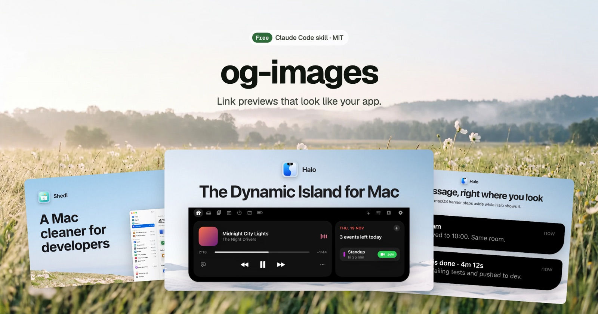
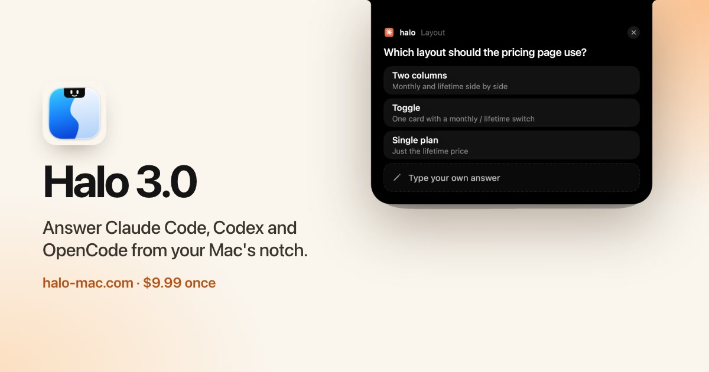
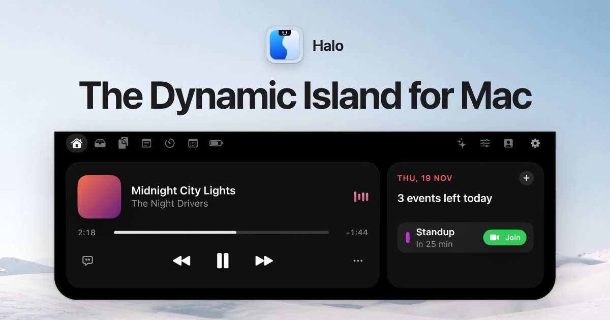
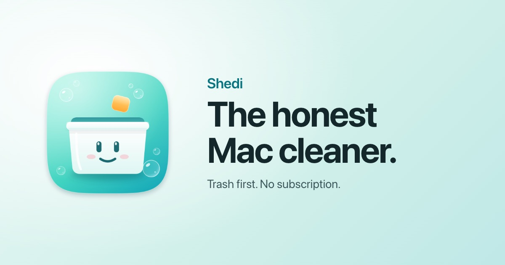
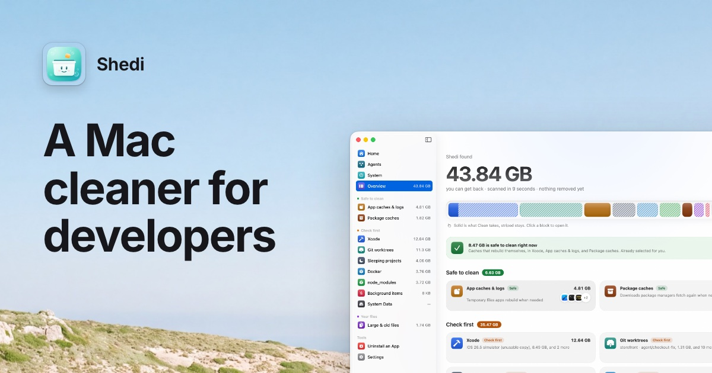
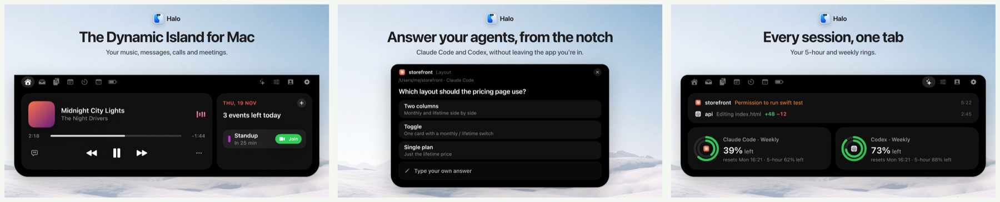
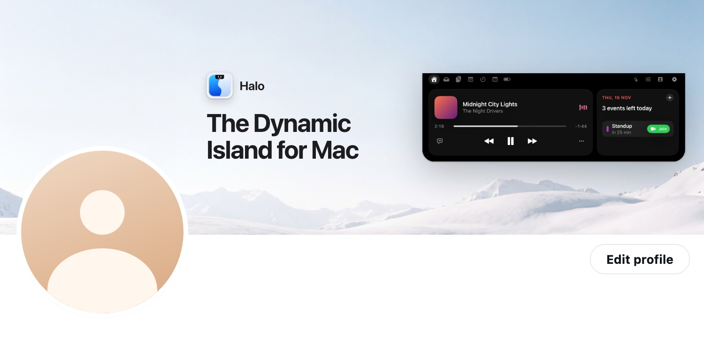

<div align="center">

# og-images

**Link previews that look like your app.**<br>
A free Claude Code skill that makes your app's launch images from its real UI: the link preview, a Product Hunt
gallery and an X header. Then it checks every file before it hands them to you.

[](#install) [](LICENSE) [](#requirements) [](https://github.com/abdiraimov-otabek/og-images/stargazers)

[Install](#install) · [What it makes](#what-it-makes) · [Before and after](#before-and-after) · [How it works](#how-it-works) · [FAQ](#faq)

</div>



## Why

Your link preview is the first thing people see of your app: in X, Slack, iMessage, Reddit and Product Hunt. Most
indie apps ship a logo on a gradient, or nothing. og-images reads your repo and makes cards that show the real app,
in your colours and your site's own words, at every size each platform asks for.

## Install

In Claude Code (2.1.275 or later):

```
/plugin install og-images --marketplace abdiraimov-otabek/og-images
```

On an older Claude Code: `/plugin marketplace add abdiraimov-otabek/og-images`, then
`/plugin install og-images@og-images`.

Then open your app's repo and ask:

```
Make the link preview, Product Hunt gallery and X header for this app
```

On first use the skill installs Playwright 1.59.1 into its own folder, never your repo, to render the images.

<details>
<summary>Install without the plugin system</summary>

```bash
git clone https://github.com/abdiraimov-otabek/og-images
ln -s "$PWD/og-images/skills/og-images" ~/.claude/skills/og-images
```

Then run `/reload-skills` in Claude Code.
</details>

### Requirements

- macOS with Claude Code
- Node.js 20 or newer
- Your app's icon and at least one real screen of the app, or a way to capture one (the skill looks for your app's own
  demo or snapshot mode first, and ships a one-line window capture for Mac apps)

It writes only to `launch-assets/og/` and `launch-assets/brand.json` in your repo.

## What it makes

| File | Size | What is in it |
|---|---|---|
| `og.png` | 1200×630 | Your icon and name, a large title that still reads at 300 px wide, a real capture, on your brand colours or a bright wallpaper |
| `og-<page>.png` | 1200×630 | Optional: one per page of your site, titled from each page's own `<title>` or `<h1>` |
| `ph/01…06.png` | 1270×760 | A Product Hunt gallery: slide 1 is the hero, each other slide one benefit |
| `x-header.png` | 1500×500 | Your X header, with text kept clear of your profile photo and the phone crop |
| `meta.html` | | The `og:image`, `twitter:card`, size and alt tags, ready to paste |

Sizes are checked against Product Hunt's and X's own help pages, with dates, in
[sizes.md](skills/og-images/references/sizes.md).

## Before and after

| | Before: the site's own card | After: og-images |
|---|---|---|
| **Halo** |  |  |
| **Shedi** |  |  |

### Product Hunt gallery



### X header, clear of your profile photo



The avatar zone was measured on x.com itself, on desktop and on a phone. The render fails if any text or UI lands in it.

## How it works

1. **Brand.** It reads your repo (README, site, asset catalog, `Info.plist`, CSS) and writes `launch-assets/brand.json`:
   name, one-liner, colours, fonts, icon. It asks you only for what it could not find.
2. **Real captures.** It uses your app's real screens, never drawn or generated UI: focused window, animations settled,
   neutral demo data.
3. **Your words.** Titles are your site's own sentences, shortened. Never paraphrased, never a number that is not on
   your site.
4. **Render.** HTML and CSS rendered by Playwright at the exact pixel size, the same bytes on every run.
5. **Check the files.** Every PNG is measured before you see it:
   - exact size and no alpha channel
   - text contrast of at least 4.5:1, on the real pixels behind the words
   - a minimum title size, so it reads in a feed at 600 px and as a 300 px thumbnail
   - the font that actually drew the text (a silent fallback to Helvetica or Times fails)
   - the X avatar zone and phone crop
   - how much of the card the app fills

   A failure stops the run with one clear line, and the skill fixes it before it reports.

## FAQ

**Does my code leave my Mac?**<br>
No. Everything renders locally. Claude Code reads your repo the same way it does for any other task.

**Does it work for iPhone apps?**<br>
The cards are built around landscape, Mac-style captures. For phone screenshots, see the App Store screenshot skill
in Gold Master Kit below.

**Can I use my own background?**<br>
Yes. It picks one of five bright wallpapers to match your accent colour, or uses a soft field of your own brand colours,
or any image you point it at.

**What is inside?**

```
skills/og-images/
  SKILL.md                 what Claude follows
  scripts/render.mjs       renders the PNGs and runs the checks
  scripts/pages.mjs        lists a site's pages with their title and h1
  scripts/preview.mjs      contact sheet at 600 px and 300 px wide
  scripts/capture-window.swift   captures one window of a running Mac app
  templates/og.html        the card
  assets/wallpapers/       five bright landscapes, 1.8 MB in all
  references/sizes.md      sizes and safe zones, with sources and dates
```

## Licence

MIT, see [LICENSE](LICENSE). The five wallpapers are made for this skill: free to use in your own launch graphics, not
to be resold or redistributed as a pack.

## From the author

I'm Otabek, and I build and sell Mac apps on my own: [Halo](https://halo-mac.com) and [Shedi](https://shedi.app). The
cards above are their real launch images. I also made the free
[dashboard-design](https://github.com/abdiraimov-otabek/dashboard-design-skill) skill.

og-images is one skill from **[Gold Master Kit](https://goldmasterkit.com)**, a paid pack for Mac and iOS launches. It
adds App Store screenshots at Apple's exact sizes today, with launch copy, a landing page and a promo video in progress.
